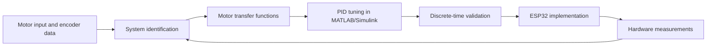

# Mobile Robot PID

**From DC motor identification in MATLAB/Simulink to discrete-time PID control on ESP32.**

This project investigates a two-motor mobile robot through motor modeling, system identification, forward and inverse kinematics, and PID controller design. Each DC motor is equipped with an encoder specified as **11 pulses per revolution (PPR)**. The workflow uses MATLAB/Simulink to estimate and validate motor transfer functions, tune the controllers with PID Tuner, and obtain a discrete-time controller in the **z-domain** for implementation on an ESP32.

> **Repository status:** Documentation scaffold. MATLAB scripts, Simulink models, measurement data, firmware, and experimental results will be uploaded by the author. No runnable implementation or verified performance results are included yet.

## Project objectives

- Identify separate transfer functions for the left and right DC motors.
- Model the robot's forward and inverse kinematics.
- Design and tune motor-speed PID controllers in MATLAB/Simulink.
- Discretize and validate the controllers at a defined sampling period.
- Implement the discrete control law on ESP32 and compare hardware measurements with simulation.

## Control workflow



The intended robot control structure is:

```text
Body velocity commands (v, omega)
              |
       Inverse kinematics
              |
   Left/right wheel-speed references
              |
   Two discrete PID speed controllers
              |
      Motor driver -> DC motors
              |
    Encoder counts -> speed estimates
              |                  |
        PID feedback      Forward kinematics
```

## 1. Motor modeling and system identification

Collect time-stamped motor input and encoder measurements for each motor. Estimate the motor dynamics from these data and validate each model on a separate dataset.

The motor-speed models are written as:

$$G_L(s)=\frac{\Omega_L(s)}{U_L(s)},\qquad G_R(s)=\frac{\Omega_R(s)}{U_R(s)}.$$

Here, $U$ is the explicitly defined motor input and $\Omega$ is angular velocity. Record whether the input is motor voltage, normalized PWM duty cycle, or another command: those choices change the model's gain and units. Record whether the measured speed refers to the motor shaft or the wheel shaft.

Model order, coefficients, delays, operating range, and validation results are to be supplied with the uploaded models. Simulation evaluates a model; identification estimates its parameters from data.

## 2. Encoder interpretation

The stated encoder specification is **11 PPR**. Confirm the manufacturer's definition, encoder location, and decoding mode before converting counts to speed.

If 11 PPR means 11 cycles on one encoder channel per motor-shaft revolution, and $q$ is the number of counted edges per cycle, then:

$$N_{\mathrm{motor}}=11q.$$

For an encoder upstream of a gearbox with ratio $g$ (motor revolutions per wheel revolution):

$$N_{\mathrm{wheel}}=11qg.$$

For signed count increment $\Delta n$ over interval $\Delta t$, wheel speed is:

$$\omega_{\mathrm{wheel}}=\frac{2\pi\Delta n}{N_{\mathrm{wheel}}\Delta t}.$$

Use $g=1$ when counts are already referenced to the wheel shaft. Do not automatically multiply by four: quadrature decoding and the encoder datasheet must agree. Low counts per sampling interval can cause speed quantization, so document any measurement window or speed filtering.

## 3. Forward and inverse kinematics

The equations below assume a **differential-drive robot** with two equal-radius driven wheels, rolling without lateral slip. Confirm this assumption against the actual chassis.

Let $r$ be wheel radius, $b$ the distance between wheel centers, and $\omega_L,\omega_R$ the signed wheel angular velocities. Positive wheel speeds move the robot forward; positive body yaw rate is counterclockwise.

**Forward kinematics:**

$$v=\frac{r}{2}(\omega_R+\omega_L),\qquad \omega=\frac{r}{b}(\omega_R-\omega_L).$$

**Inverse kinematics:**

$$\omega_L^*=\frac{v^*-\frac{b}{2}\omega^*}{r},\qquad \omega_R^*=\frac{v^*+\frac{b}{2}\omega^*}{r}.$$

Use wheel-shaft speeds in these equations. Convert motor-shaft speeds through the gearbox ratio when necessary.

## 4. PID design and discretization

Tune a controller for each motor in MATLAB PID Tuner or the applicable Simulink PID tuning workflow. Document the controller form, gains, derivative filter, input/output units, and tuning targets.

A continuous-time parallel PID controller with derivative filtering can be represented as:

$$C(s)=K_p+\frac{K_i}{s}+\frac{K_d s}{T_f s+1},$$

where $T_f$ is the derivative-filter time constant.

Choose the controller sampling period $T_s$ and a discretization method, then obtain $C(z)$ (also referred to as PID(z)). Validate the resulting sampled-data loop before transferring it to firmware. Record the actual method and resulting coefficients; they have not been selected in this scaffold.

For a normalized controller transfer function written in powers of $z^{-1}$,

$$C(z)=\frac{\sum_{i=0}^{m}b_i z^{-i}}{1+\sum_{j=1}^{n}a_j z^{-j}},$$

the corresponding linear difference equation is:

$$u[k]=\sum_{i=0}^{m}b_i e[k-i]-\sum_{j=1}^{n}a_j u[k-j].$$

This expression describes the unsaturated linear controller. Firmware must also define initialization, output limits, anti-windup, derivative filtering, and state handling. Simply clamping the output of a transfer-function recurrence does not by itself implement anti-windup.

## 5. ESP32 implementation checklist

- [ ] Specify ESP32 board, motor driver, power supply, and pin assignments.
- [ ] Verify encoder polarity, counting mode, and counts per wheel revolution.
- [ ] Use a fixed control period consistent with the discrete model.
- [ ] Preserve the simulated controller's units, signs, coefficients, and state updates.
- [ ] Implement PWM limits, anti-windup, and defined stop/reset behavior.
- [ ] Log reference speed, measured speed, control output, and timestamps.
- [ ] Compare individual motor step responses and robot motion with simulation.

## Software and hardware

| Component | Purpose / status |
| --- | --- |
| MATLAB and Simulink | Modeling, analysis, and simulation; release to be recorded |
| Control System Toolbox | Transfer functions, PID design, and discretization |
| Simulink Control Design | Required if using its model-based PID tuning workflow |
| System Identification Toolbox | Required if using its identification tools |
| ESP32 toolchain | Framework, board package, and versions to be specified |
| Two DC motors and 11-PPR encoders | Motor, gearbox, and encoder details to be specified |
| Motor driver and robot chassis | Driver model, wheel radius, and track width to be specified |

## Suggested organization for future uploads

The following directories are a proposed layout; they will appear when files are uploaded.

```text
Mobile-Robot-PID/
├── README.md
├── CONTRIBUTING.md
├── .gitignore
├── .gitattributes
├── matlab/             # Initialization, identification, tuning, analysis
├── simulink/           # Motor, robot, and control-loop models
├── firmware/           # ESP32 source and build configuration
├── data/               # Documented measurement and validation datasets
├── docs/               # Derivations, wiring, and parameter definitions
└── results/            # Exported figures and comparison tables
```

## Getting started

At present, this repository contains documentation only. After uploading the implementation:

1. Record the tested MATLAB release, required toolboxes, and ESP32 toolchain.
2. Add the entry script/model and the command or steps needed to run it.
3. Provide motor parameters, encoder conversion, chassis dimensions, and sample times.
4. Include at least one reproducible dataset and a simulation example.
5. Add firmware build/upload instructions and the matching wiring diagram.

## Validation and results

No numerical performance claims are made yet. Future results should report the test conditions, sample period, controller settings, and data source alongside metrics such as rise time, settling time, overshoot, steady-state error, and speed-tracking RMSE. Separate simulation results from hardware measurements.

## References

- [MathWorks: PID Tuner](https://www.mathworks.com/help/control/ref/pidtuner.html)
- [MathWorks: PID controller models](https://www.mathworks.com/help/control/ref/pid.html)
- [MathWorks: Discrete PID Controller block](https://www.mathworks.com/help/simulink/slref/discretepidcontroller.html)

## License

A license has not yet been selected. See this section for updates before reusing or redistributing project material.
